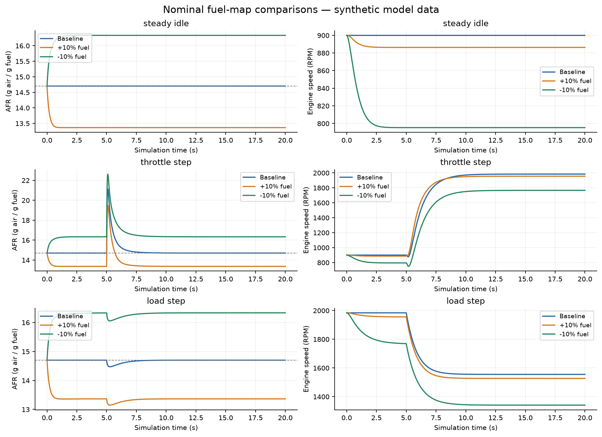
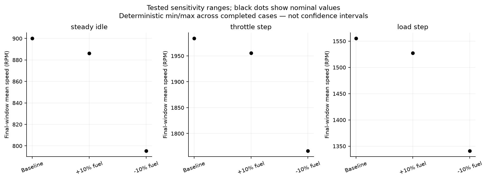
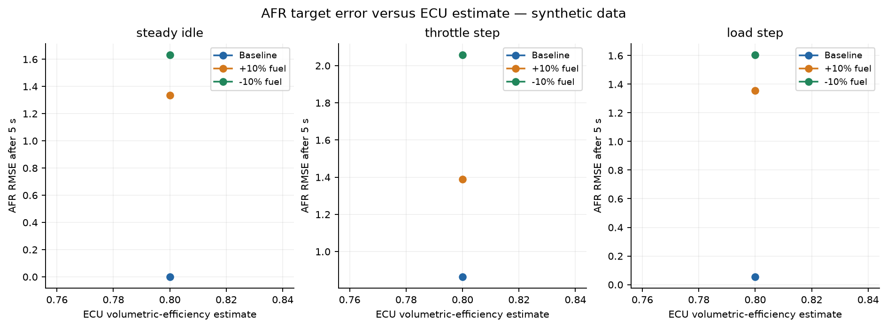

# Controlled fuel map comparisons and sensitivity

Study status: complete. Model: 0.3.0-fuel-map-coupling. Study protocol: 0.1.0.
All data are synthetic. Results concern the stated equations, not measured vehicle performance.

## Method

Completed 9 of 9 conditions; 0 failed conditions. One deterministic execution per condition.
One-at-a-time parameter levels are illustrative probes, not measured tolerances. All cases preserve
the stored initial states, scenarios, maps, integration step and reporting rate except the named parameter.
Repeated identical traces verify software reproducibility and do not create independent physical samples.

## Tested sensitivity ranges

These are deterministic min/max ranges across completed cases, not confidence intervals.

| Scenario | Map | Cases | Final mean RPM range | AFR RMSE range |
| --- | --- | ---: | ---: | ---: |
| steady_idle | baseline | 1 | 900.00–900.00 | 0.0000–0.0000 |
| steady_idle | plus10 | 1 | 886.27–886.27 | 1.3364–1.3364 |
| steady_idle | minus10 | 1 | 795.28–795.28 | 1.6333–1.6333 |
| throttle_step | baseline | 1 | 1983.71–1983.71 | 0.8640–0.8640 |
| throttle_step | plus10 | 1 | 1955.28–1955.28 | 1.3895–1.3895 |
| throttle_step | minus10 | 1 | 1766.28–1766.28 | 2.0589–2.0589 |
| load_step | baseline | 1 | 1555.11–1555.11 | 0.0546–0.0546 |
| load_step | plus10 | 1 | 1527.08–1527.08 | 1.3566–1.3566 |
| load_step | minus10 | 1 | 1340.91–1340.91 | 1.6063–1.6063 |

## AFR error ranking

The smallest AFR RMSE in each case is listed for the tested maps only. Ties within 1e-9 are retained.
This does not identify an optimal real-engine tune.

| Case | Scenario | Lowest AFR RMSE map |
| --- | --- | --- |
| nominal | steady_idle | baseline |
| nominal | throttle_step | baseline |
| nominal | load_step | baseline |

## Reproducibility

Additional repeat checks: 2; matching numerical trace hashes: 2.
Per-run config, frozen map, CSV, numerical hash and metrics are linked by the manifest.

## Figures







Figures are also saved as PDFs. figure_provenance.json identifies plotted conditions and dependency versions.

## Limitations and interpretation

The nominal ECU estimate matches the plant by construction. The lambda penalty and its coefficient are assumed.
Map rankings and RPM effects are conditional on these assumptions. Changing the ECU estimate can change
which map compensates its bias. This is internal robustness evidence, not independent validation.
One-at-a-time variation does not estimate interactions or probabilistic uncertainty.
Settling and overshoot refer to the same-model equilibrium with the predefined band and confirmation period.
Unavailable settling time means it was not observed by the end; it is not replaced by zero.
Ignition, external calibration, critical literature review and the E4 wall-clock logging experiment remain open.

## Reproduction

Install the recorded plotting requirements once, then reproduce from this directory:

```text
python -m pip install --target .deps/research -r requirements-research-lock.txt
python research_study.py --plan study_plan.json --output-dir reproduced
```

To regenerate figures from these stored datasets without rerunning simulations:

```text
python research_study.py --render-only .
```

Use --plot-deps PATH to reuse an existing matching plotting environment. Use --no-plots for numerical-only replay.
UUIDs, wall times and file metadata may differ; compare numerical telemetry and metrics.
